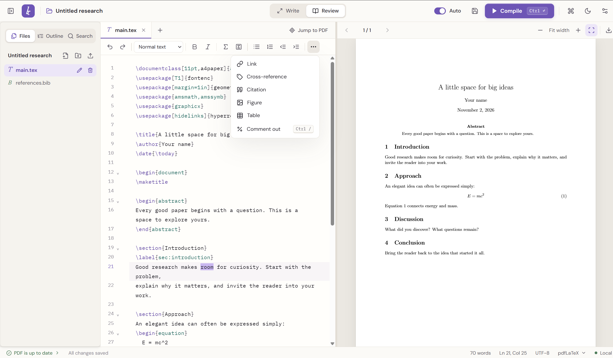

# localTEX

A LaTeX editor for Windows that runs entirely on your own computer. Write on the left, see the PDF on the right, and keep your work in ordinary folders that any other LaTeX editor can open.



- **Overleaf-style writing:** a formatting toolbar, live PDF preview, spell check, word count, and jumping between source and PDF.
- **No account and no cloud.** Your files never leave your PC. localTEX only goes online to download LaTeX packages.
- **Packages handled for you.** When a document uses a package you don't have, localTEX downloads it before compiling.
- **Works with your existing projects** from Overleaf, TeXstudio, TeXworks or VS Code.

## Install

You need three things, installed in this order:

| | What | Why |
| --- | --- | --- |
| 1 | [MiKTeX](https://miktex.org/download) | The LaTeX system that actually builds your PDF. |
| 2 | [Strawberry Perl](https://strawberryperl.com/) | latexmk, the tool that runs LaTeX for you, needs Perl, and MiKTeX doesn't include it. |
| 3 | localTEX | The editor. |

localTEX runs on Windows 10 and 11 (64-bit). You'll need an internet connection the first time you open it.

### Step 1: Install MiKTeX

1. Download the installer from [miktex.org/download](https://miktex.org/download) and run it.
2. The default choices are fine, including "Install missing packages on-the-fly" (localTEX manages package downloads itself, whatever you pick there).
3. When it finishes, open **MiKTeX Console** from the Start menu once. If it offers to finish setup or check for updates, let it.

### Step 2: Install Strawberry Perl

1. Download the 64-bit installer (`.msi`) from [strawberryperl.com](https://strawberryperl.com/) and run it.
2. Keep the default options.

### Step 3: Install localTEX

1. Download `localTEX_<version>_x64-setup.exe` from the [latest release](https://github.com/atikulmunna/localTEX/releases/latest) and run it.
2. Windows may show **"Windows protected your PC"**, because the installer isn't digitally signed yet. Click **More info**, then **Run anyway**.
3. localTEX installs for your Windows account only, so it doesn't need administrator rights. It adds a Start menu entry and a desktop shortcut.

The installer also takes care of Microsoft Edge WebView2, which draws localTEX's window. It's already part of Windows 11; on Windows 10 the installer downloads it if it's missing.

### Step 4: First launch

The first time localTEX opens, a **LaTeX setup** window checks that MiKTeX and Perl work, then downloads about 27 commonly used LaTeX packages (amsmath, graphicx, hyperref, TikZ, biblatex and others). On a fresh MiKTeX this takes a few minutes. You can close the window and start writing while it runs in the background; a compile you start meanwhile waits for it to finish.

localTEX remembers when setup has succeeded and skips it on later launches. To run it again, for example after reinstalling MiKTeX, use **Settings → LaTeX → Run setup again**.

### Using TeX Live instead of MiKTeX

TeX Live works too, and it includes its own Perl, so you can skip Step 2. TeX Live doesn't download packages on demand, so add missing ones with TeX Live Manager (or install the full scheme).

### If something goes wrong

| What you see | What to do |
| --- | --- |
| Setup says a program was not found | MiKTeX isn't installed, or it was installed while localTEX was open. Close localTEX and open it again. If MiKTeX is in an unusual place, set its `bin` folder in **Settings → LaTeX → LaTeX folder** (normally `C:\Users\<you>\AppData\Local\Programs\MiKTeX\miktex\bin\x64`). |
| Setup asks for Perl | Install Strawberry Perl (Step 2), then close and reopen localTEX. |
| MiKTeX says its setup is unfinished | Open **MiKTeX Console** once and let it finish. |
| A package fails to download | Check your internet connection, then compile again. The Problems panel names the missing file and offers **Install and compile**. |
| Compile asks you to choose the main document | Your project has several files that start with `\documentclass`. Pick the one that is your paper; localTEX remembers it. |
| Nothing else helps | **Settings → LaTeX** has **Save and check tools** and **Test compilation**, which show exactly which part isn't working. |

## Getting started

### Start a new project

On the welcome screen, click **New project**, pick **Research article** or **Thesis**, choose a name and where to save it. localTEX creates the folder with a ready-to-compile `main.tex`.

### Open an existing project

Click **Open folder** and choose the folder that contains your `.tex` files. Recent projects appear on the welcome screen.

**From Overleaf:** in your Overleaf project, open **Menu → Download → Source**. Right-click the downloaded `.zip`, choose **Extract All**, then open the extracted folder in localTEX. localTEX detects the main document and the right engine (XeLaTeX for documents that load `fontspec`, for example).

### Compile and view the PDF

Click **Compile** (or press **Ctrl+Enter**). The PDF appears on the right and scrolls continuously through every page. With **Auto** on (the default), localTEX saves and recompiles about a second after you stop typing.

- **Which file is compiled:** localTEX finds the file with `\documentclass`. If a project has several (an Elsevier template's `highlights.tex`, for example), it uses `main.tex`, and asks you only if it still can't tell. You can change it any time in **Settings → Project → Root document**, or with a `% !TeX root = main.tex` comment at the top of a file.
- **Errors** show up in the editor next to the line and in the **Problems** panel below, errors first. As in Overleaf, an error LaTeX can recover from (a character it can't print, for example) doesn't cost you the PDF: you get the PDF, and the status bar says how many errors to fix. An error in a bibliography entry says so and quotes the entry. If a build fails outright, the last good PDF stays visible, marked as a previous build.
- **Figures** can be PNG, JPG or PDF, and EPS figures (common in IEEE and Elsevier templates) are converted automatically when you compile with pdfLaTeX. If figures appear as empty boxes with their file names, the document is using the `draft` class option; change it to `final`.
- **Missing packages** are downloaded before compiling. The status bar shows **Getting packages…** while that happens.
- **Export PDF** (above the preview) saves a copy of the PDF wherever you like. The working PDF lives in the project's hidden `.localtex` folder.

## Writing

- **Formatting toolbar.** Select text and click: bold, italic, section headings, bulleted and numbered lists, indent, links, math, cross-references and citations (which list your labels and bibliography keys), and ready-made figure and table blocks. Press **Tab** to move between the parts of a figure or table to fill in. Tools that don't fit move into a **More** menu.
- **Spell check** underlines misspelled words in your text but not in commands, math or labels. Right-click a word for suggestions or to add it to your dictionary. It uses the languages installed in Windows (**Windows Settings → Time & language → Language & region**); choose one in **Settings → Spelling language**.
- **Jump between source and PDF.** Press **Ctrl+Shift+L** or click **Jump to PDF** to see where you are in the PDF. Double-click anywhere in the PDF to jump back to that line.
- **Word count** in the status bar counts your document's words, including files you `\input` or `\include`, and leaves out commands, math and comments.
- **Navigate long documents** with the **Outline** tab in the sidebar, fold sections and environments from the left margin, and search every file with the **Search** tab.
- **Write** and **Review** (top bar, or **Ctrl+J**) switch between a distraction-free editor and the editor beside the PDF.
- **Paper** and **Graphite** themes: **Settings → Appearance**.

### Files

The sidebar's **Files** tab shows your project's folders. Create files and folders, rename or move them, and delete them (they go to the Recycle Bin). Add images and other files with the upload button, or drag them in from File Explorer; a copy never overwrites an existing file (a second `plot.png` becomes `plot (2).png`). Click an image or PDF to preview it.

Your work is saved with **Ctrl+S**, and Auto compile saves too. If localTEX closes unexpectedly, it offers to restore unsaved changes the next time you open the project. If another program changes a file you have open, localTEX reloads it, or asks first if you have unsaved edits.

## Keyboard shortcuts

| Action | Keys |
| --- | --- |
| Compile | Ctrl+Enter |
| Save all files | Ctrl+S |
| Open project | Ctrl+O |
| Command palette | Ctrl+K |
| Switch Write / Review | Ctrl+J |
| Show or hide the sidebar | Ctrl+Shift+B |
| Bold / italic | Ctrl+B / Ctrl+I |
| Comment lines | Ctrl+/ |
| Fold / unfold a section | Ctrl+Shift+[ / Ctrl+Shift+] |
| Find in the current file | Ctrl+F |
| Add a cursor | Ctrl+click |
| Select the next match | Ctrl+D |
| Select a column | Alt+drag |
| Jump from source to PDF | Ctrl+Shift+L |
| Jump from PDF to source | Double-click the PDF |

## Working alongside other editors

A localTEX project is an ordinary folder, so the same folder opens in TeXstudio, VS Code, TeXworks, or Overleaf (zip it and upload it). localTEX only adds a hidden `.localtex` folder for its settings and build output, which other editors ignore.

- Files keep their own line endings and encoding when saved, so they don't show every line as changed in git. Older projects saved in the Windows `latin1` / `ansinew` encoding open and save correctly; the status bar shows the encoding.
- `% !TeX root` and `% !TeX program` comments work as they do in TeXstudio and VS Code.
- Build leftovers from other editors (`.aux`, `.log`, `.synctex.gz` and similar) and converted EPS figures (`-eps-converted-to.pdf`) are hidden from the file list.
- Besides `.tex` and `.bib`, the editor opens style and class files (`.sty`, `.cls` and others), `latexmkrc`, and text formats such as `.txt`, `.md`, `.csv`, `.json` and `.yaml`.
- A project's own `latexmkrc` (custom build rules for glossaries or nomenclature, for example) is used only after you allow it in **Settings → Project**, because such a file can run any program.

## Privacy

There are no accounts, analytics, AI features or cloud compilation. Fonts and the PDF viewer are built in. localTEX connects to the internet only to download LaTeX packages: during setup, and when a document needs one that isn't installed. You can turn the second one off in **Settings → LaTeX → Download missing packages automatically**; failed builds then offer **Install and compile** instead.

## Limits

Source files open up to 8 MB each, and a project can hold up to 20,000 files. Renaming a file doesn't update the `\input`, `\includegraphics` or bibliography commands that refer to it. Encodings other than UTF-8 and Windows-1252 (for example Cyrillic code pages) display some characters wrongly; convert those files to UTF-8 to edit them comfortably.

## Uninstall

Open **Windows Settings → Apps → Installed apps**, find **localTEX**, and choose **Uninstall**. Your project folders are never removed. MiKTeX and Strawberry Perl stay installed until you uninstall them the same way.

## For developers

**Status:** the unit, interface and Rust tests pass, the real-engine tests pass with MiKTeX 26.5 for pdfLaTeX, XeLaTeX and LuaLaTeX, and first-launch setup has been run against a real MiKTeX installation. Installing, upgrading and uninstalling on a clean Windows machine hasn't been tested yet, and the installer isn't code-signed.

### Build from source

Requirements: Windows 11 x64, Node.js 24, Rust with the MSVC toolchain, and Visual Studio C++ build tools with a Windows SDK. Compiling documents also needs MiKTeX and Perl, as above.

```powershell
npm ci
cargo fetch --manifest-path src-tauri/Cargo.toml
npm run desktop
```

`npm run dev` opens a browser preview with a labeled sample project. It doesn't compile LaTeX or access folders on disk.

### Build the installer

```powershell
npm run package
```

The installer is written to `src-tauri/target/release/bundle/nsis/`. The first run may download the NSIS tooling and the WebView2 bootstrapper. Installers are **unsigned** unless a signing certificate is configured, so don't describe an unsigned build as a verified public release. To build only the executable, run `npm run tauri -- build --no-bundle`.

### Tests

```powershell
npm test
cargo test --manifest-path crates/localtex-core/Cargo.toml
npm run build
cargo test --manifest-path src-tauri/Cargo.toml
npx playwright install chromium
npm run test:e2e
```

The browser tests drive the interface through a stand-in for the desktop backend; they don't replace testing the real app and installer.

With pdfLaTeX, XeLaTeX and LuaLaTeX installed, run the opt-in compiler tests:

```powershell
cargo test --manifest-path crates/localtex-core/Cargo.toml --test latex_integration -- --ignored --test-threads=1
```

They compile multi-file papers with a bibliography and images in a folder whose path contains spaces and Bangla characters, check SyncTeX, and confirm a broken build fails. Set `LOCALTEX_TOOL_DIRECTORY` to use a TeX folder that isn't on PATH. Run them from PowerShell, not Git Bash: Git Bash puts its own Perl first on PATH, and MiKTeX can't read the Unix-style paths it passes to latexmk. The first LuaLaTeX run builds a font cache and can take a few minutes.

To check the TeX tools, or run first-launch setup with its progress printed, without the app:

```powershell
cargo run --manifest-path crates/localtex-core/Cargo.toml --example doctor
cargo run --manifest-path crates/localtex-core/Cargo.toml --example setup
```

Both take an optional TeX folder as their first argument. Open a new terminal after installing MiKTeX or Perl so it sees the updated PATH. (The app itself reads the PATH from the registry when it starts, so reopening the app is enough.)

### How it works

- `src/`: the React interface, CodeMirror editor, PDF.js viewer, the typed bridge to the desktop backend, and the indexing and diagnostics logic.
- `crates/localtex-core/`: file safety, conflict-checked atomic writes, encodings, templates, compiler setup, package downloads, and Windows process handling. It is tested independently of the app.
- `src-tauri/`: the desktop commands, file watching, build events, recovery drafts, spell checking, and Windows packaging.

Builds run `latexmk` with `-norc`, so no system, user or project rc file is loaded unless the user trusts the project's own `latexmkrc`; localTEX's output folder and safety options apply either way. Engines are limited to pdfLaTeX, XeLaTeX and LuaLaTeX. latexmk runs with `-f`, so LaTeX keeps going past recoverable errors (as on Overleaf); a PDF written during the build is shown even though latexmk exits with an error, and the Problems list reads only the last LaTeX pass. Without consent, LaTeX runs in the distributions' default restricted mode (`-shell-restricted`), which allows only a fixed list of safe helpers such as the EPS-to-PDF converter. Full shell escape needs the user's consent, recorded in app data, so copying a project's configuration can't grant it on another PC.

Missing packages are found with `findtexmf`, which only searches and never opens MiKTeX's install prompt. Each one is fetched by compiling a tiny document that loads it with MiKTeX's installer allowed, so MiKTeX resolves the right package and its dependencies. Folders with non-ASCII names are compiled through their Windows short (8.3) names or an ASCII junction, because Perl and MiKTeX can't handle them otherwise; SyncTeX positions are translated back.

Each project's settings live in `.localtex/project.json` (version `1`, optional `root` and `engine`, a `shellEscape` flag, and `latexmkrc`), and build output in `.localtex/build/`. App settings and recovery drafts are stored in the application data folder for `app.localtex.studio`.

References: [Tauri Windows packaging](https://v2.tauri.app/distribute/windows-installer/), [CodeMirror](https://codemirror.net/), [PDF.js](https://mozilla.github.io/pdf.js/) (pinned to 6.2.108), [latexmk](https://ctan.org/pkg/latexmk), [MiKTeX installer control](https://docs.miktex.org/manual/miktex-pdftex.html).

## License

localTEX is released under the [MIT License](LICENSE). MiKTeX, TeX Live and Strawberry Perl are separate projects with their own licenses.
